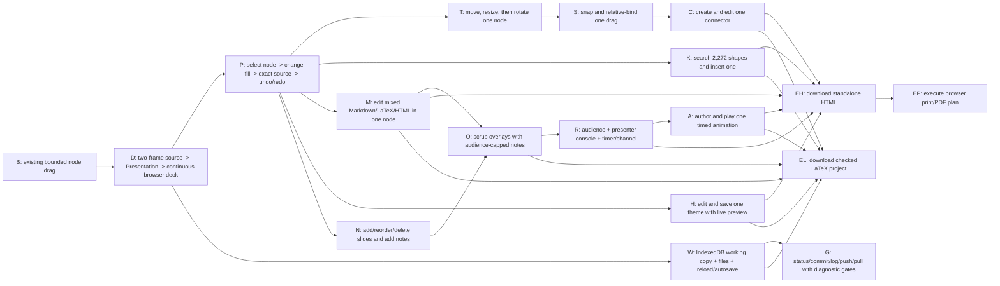

# Web UI behavioural parity inventory

## Question

Which observable behaviours exist in the original `editor`, which of them work
through the current SlideBlaster2 browser composition, and which have only a
shared Haskell contract or no executable implementation yet?

This is a time-bounded migration inventory, not a product decision. The
original TypeScript product is evidence for existing behaviour, but its known
gaps are not architecture requirements. Accepted ADRs, specifications, and the
knowledge graph remain authoritative.

## Result

SlideBlaster2 is not at general editor parity. Its current real browser path is
deliberately narrow:

- the canvas-first shell, ordered command groups, responsive collapse, and
  retained Source/Shapes pane visibility work;
- exact source replacement, one-text-value browser save/load, and plain DOM
  text measurement work;
- one bounded TikZ node and one straight connector render through real GHC
  Wasm; dragging the node performs a revision-fenced, reparse-and-verify
  Haskell transaction and updates exact source;
- malformed or unsupported source remains authoritative while the last-good
  bounded canvas becomes inert.

Everything else below is either shared Haskell capability that has not crossed
the browser boundary, or is still missing. In particular, the packaged
draw.io-derived catalog asset is not a working palette merely because it exists
under `hosts/web/dist/catalog/`.

The migration also intentionally exceeds the original in three places:

- the original has no node-rotation gesture or source edit;
- the original has discrete overlay steps but no timed animation system;
- the original has standalone HTML and browser print/PDF, but no LaTeX writer.

Those are product additions, not parity claims.

## Date, method, and evidence standard

Observed on 2026-07-23 by reading the original implementation/tests, the current
packaged browser host, and the public Haskell modules/tests.

The three current browser smokes were rerun against the local packaged host:

```sh
node .sessions/slideblaster2-web-parity/baseline-smoke.cjs
node .sessions/slideblaster2-web-parity/shell-smoke.cjs
node .sessions/slideblaster2-web-parity/slice1-roundtrip-smoke.cjs
```

All three passed. The Slice 1 smoke observed real Wasm responses for ready,
verified-change, unchanged, syntax-only, and stale-revision cases, exact moved
source, connector following, inert last-good rendering, direct-edit precedence,
and strict schema rejection. The shell smoke observed pane-state retention and
persistence, disabled future commands, format collapse, and narrow-screen
stacking.

The first fully qualified path in a table cell is relative to the project root;
subsequent short names in that cell are siblings unless another directory is
shown. Line references are to the audited 2026-07-23 worktrees.

### Status vocabulary

- **Working end-to-end** means a real browser gesture crosses its complete
  intended composition and produces the asserted user-visible result. Semantic
  behaviour must cross real Wasm/shared Haskell; host-owned pane preferences do
  not need a fake engine round trip. A bounded scope is stated explicitly.
- **Contract-only** means meaningful shared Haskell types plus executable laws
  or a pure planner exist, but the packaged browser lacks at least one required
  reader, reducer, protocol, render/event translation, or effect interpreter.
- **Missing** means a command name, placeholder, or data field may exist, but
  the required semantic transition, general source complement, or host
  implementation does not. Merely naming an operation is not an implementation.

Passing a package test never upgrades a browser feature from **Contract-only**
to **Working end-to-end**.

## Current browser baseline

| Behaviour | Exact current evidence | Boundary |
| --- | --- | --- |
| Canvas-first shell | `slideBlaster2/hosts/web/index.html:11-220`; pane availability/defaults and retained DOM state in `slideBlaster2/hosts/web/src/ui/workspace.js:6-65`; browser assertions in `.sessions/slideblaster2-web-parity/shell-smoke.cjs:39-175` | Files is disabled. Shapes is only an enabled pane toggle around disabled placeholder cells. History, Insert, formatting, Present, Export, and zoom controls remain disabled. |
| Exact source workbench | `slideBlaster2/hosts/web/src/main.js:70-115,140-243`; browser assertions in `.sessions/slideblaster2-web-parity/baseline-smoke.cjs:89-226` | Revisions and direct actions are still owned by host JavaScript rather than `slideblaster-app`. Save/load is one UTF-16 text value in `localStorage`, not the shared conditional-byte workspace contract. |
| Bounded Haskell canvas | Analysis/adoption in `slideBlaster2/hosts/web/src/main.js:85-115,262-319,362-403`; one-node/one-line translation and drag intent in `slideBlaster2/hosts/web/src/ui/tikz-renderer.js:27-79,84-173,203-226` | The active engine protocol exposes only inspect, replace, `analyze_tikz`, and `move_tikz_node`: `slideBlaster2/packages/slideblaster-protocol/src/SlideBlaster/Protocol/Codec.hs:142-173,210-228`. |
| Real round trip and fencing | Real-Wasm fixtures in `.sessions/slideblaster2-web-parity/slice1-roundtrip-smoke.cjs:135-263`; browser paint, drag, no-op, and inert last-good checks at `:273-370`; gesture/direct-edit races and schema failure at `:390-499` | The bounded reader contains exactly one node and one connector: `slideBlaster2/packages/slideblaster-tikz/src/SlideBlaster/TikZ/Internal/Types.hs:103-111,310-318`; parser diagnostics explicitly say so at `Internal/Parser.hs:438-567`. |

## Feature matrix

### Composition, source authority, and deck

| Feature | Original implementation and test evidence | SlideBlaster2 evidence | Status and exact remaining gap |
| --- | --- | --- | --- |
| Canvas-first chrome and pane retention | Shared chrome contains Files, Source, Shapes, History, Insert, formatting, Present, Export, navigator, properties, zoom, overlay controls, and resizers: `editor/packages/app/src/chrome.ts:11-75`. Initial visibility, retained source state, resizers, and reload persistence are exercised by `editor/e2e/workspace-view.spec.ts:3-45`. | Current command groups and pane state pass end-to-end: `slideBlaster2/hosts/web/index.html:11-220`; `slideBlaster2/hosts/web/src/ui/workspace.js:6-65`; `.sessions/slideblaster2-web-parity/shell-smoke.cjs:39-175`. | **Working end-to-end**, shell subset. Full Files, navigator, properties, resizers, and working commands are not included in this verdict. |
| General authored source to semantic presentation and verified reverse edits | The original has a real Markdown/TikZ reader and local projectors, although the strict adjacent-T2 locality gate remains expected-red: `editor/e2e/browser-requirements.spec.ts:373-385`. | `slideblaster-document` provides a generic exact-source container and provenance vocabulary: `slideBlaster2/packages/slideblaster-document/test/Main.hs:14-22,30-97`. `Canvas.Edit` explicitly delegates revision fencing, projection, reparse, and verification elsewhere: `slideBlaster2/packages/slideblaster-canvas/src/SlideBlaster/Canvas/Edit.hs:1-7`. Only the bounded one-node TikZ complement is executable: `slideBlaster2/packages/slideblaster-tikz/test/Main.hs:28-45`. | **Missing**. There is no general deck/content reader, lossless CST, elaborator to `Presentation`, or provenance-guided projector for the existing semantic command set. This is the first parity dependency. |
| Tolerant invalid source | The last good deck stays visible and locked while malformed source remains editable: `editor/e2e/browser-model.spec.ts:90-113`. | Current analysis retains the last-good surface and revokes its lease: `slideBlaster2/hosts/web/src/main.js:85-115,378-403`; real browser checks at `.sessions/slideblaster2-web-parity/slice1-roundtrip-smoke.cjs:346-379`. | **Working end-to-end**, bounded to the one-node TikZ reader. General multi-frame diagnostics and leases depend on the missing reader/composition above. |
| Undo and redo | Two source-snapshot stacks, no-op suppression, branch clearing, and restore live at `editor/packages/app/src/createApp.ts:460-463,816-845,964-987`; model-based browser traces are in `editor/e2e/browser-model.spec.ts:13-88,115-130`. | Exact fresh-revision undo/redo, no-op, and branch laws exist in `slideBlaster2/packages/slideblaster-app/test/Main.hs:15-30,30-73`. The packaged buttons are disabled at `slideBlaster2/hosts/web/index.html:60-77`, and browser source revisions remain JS-owned at `hosts/web/src/main.js:35-41,70-83`. | **Contract-only**. Wire `App.Update`/history to the browser and route both direct and semantic edits through it. |
| Continuous deck and navigator | Continuous slide/notes cards and intersection-driven active selection: `editor/packages/app/src/deck.ts:1-15,173-242`; thumbnail click/arrows/add: `deckNav.ts:92-185`; PageUp/Down/Home/End and focus-gated delete: `createApp.ts:1644-1755`. Add/undo/redo is browser-tested at `editor/e2e/browser-model.spec.ts:13-49`. | A non-empty ordered presentation with stable frame IDs exists at `slideBlaster2/packages/slideblaster-presentation/src/SlideBlaster/Presentation/Model.hs:226-275,315-336`. The command vocabulary names selection, insertion, deletion, reorder, and notes at `slideBlaster2/packages/slideblaster-app/src/SlideBlaster/App/Command.hs:91-98`, but the browser has one surface and no navigator. | **Contract-only** for deck identity/order and selection vocabulary. Browser navigation, thumbnails, continuous mounting, and active/focus semantics are unwired. |
| Deck insertion, deletion, reorder, and notes mutation | The original appends new slides and supports focus-gated delete, but has no reorder: `editor/packages/app/src/createApp.ts:280-289,848-862,1644-1755`. | The operations are names only in `slideBlaster2/packages/slideblaster-app/src/SlideBlaster/App/Command.hs:91-98`; `App.Update` handles draft/history/analysis/paint/presenter events, not these commands: `slideBlaster2/packages/slideblaster-app/src/SlideBlaster/App/Update.hs:70-87,105-184`. | **Missing**. Implement semantic deck transitions plus exact source projection and one-step history before exposing controls. |

### Canvas objects, transforms, properties, and shapes

| Feature | Original implementation and test evidence | SlideBlaster2 evidence | Status and exact remaining gap |
| --- | --- | --- | --- |
| Selection and property editing | Semantic selection and single/multi/connector property routing: `editor/packages/app/src/properties.ts:61-142`; node placement/reveal/style controls at `:386-594`; canvas modifier selection at `editor/packages/app/src/canvas.ts:474-531`. Multi-selection and source reconciliation are exercised at `editor/e2e/browser-requirements.spec.ts:249-348`; style no-op history at `editor/e2e/browser-model.spec.ts:115-130`. | Semantic object, connector-handle, content-range, and frame selections exist at `slideBlaster2/packages/slideblaster-app/src/SlideBlaster/App/Selection.hs:46-101`; typed node/connector property commands at `App/Command.hs:106-125`; property precedence laws at `slideBlaster2/packages/slideblaster-canvas/test/Main.hs:21-44`. | **Contract-only**. The current renderer emits no general selectable `ElementAddress`, the host has no properties panel, and the general source projector is missing. |
| Node move | Original drag previews and commits through the canvas action contract: `editor/packages/app/src/canvas.ts:64-102,430-656`; multi-node drag is exercised at `editor/e2e/browser-requirements.spec.ts:249-320`. | The current one-node pointer gesture, revision lease, verified source adoption, and connector follow are real browser behaviour: `slideBlaster2/hosts/web/src/ui/tikz-renderer.js:84-173`; `hosts/web/src/main.js:262-319`; `.sessions/slideblaster2-web-parity/slice1-roundtrip-smoke.cjs:273-344`. | **Working end-to-end**, exactly one absolute node in the bounded TikZ subset. Multi-selection, relative placement, and general objects are not covered. |
| Resize | Eight original grips and reflow-versus-scale behaviour: `editor/packages/app/src/resizeHandles.ts:38-114,175-309`; semantic operation tests at `editor/packages/editor/src/edit/ops.test.ts:132-203`. | `ResizeElement` and `Sizing` are typed at `slideBlaster2/packages/slideblaster-canvas/src/SlideBlaster/Canvas/Edit.hs:51-69`; node sizing is part of resolved properties at `Canvas/Property.hs:349-405`. | **Contract-only**. There is no render-plan handle interaction, drag preview, source projection, or browser test. |
| Node rotation | No original node rotation action, handle, property widget, or executable test was found; `editor/packages/app/src/canvas.ts:64-102` exposes move/resize/connect but no rotate action. | Rotation is typed in `NodeProperties` and can enter a property patch: `slideBlaster2/packages/slideblaster-canvas/src/SlideBlaster/Canvas/Property.hs:310-365,385-405`. | **Missing** as an editable feature. This is a new product slice: define the handle/property gesture, coordinate meaning, exact source spelling, projector, and browser acceptance. |
| Snapping and relative binding | Grid/alignment/equal-spacing/theme-reference precedence is implemented at `editor/packages/app/src/snap.ts:1-43,125-194`; binding at `binding.ts:1-98`; focused laws at `snap.test.ts:14-131` and `binding.test.ts:18-61`. | Pure binding-before-snap, theme anchor, Alt/free, alignment, spacing, grid, independent-axis, and range laws are listed at `slideBlaster2/packages/slideblaster-canvas/test/Main.hs:27-36`; `dragResolutionIntent` produces a semantic move at `Canvas/Edit.hs:71-73`. | **Contract-only**. The browser gesture never invokes the shared snap resolver or paints guides, and no general source projector can commit relative placement. |
| Connector rendering dependency | Original connector geometry reroutes during dependent moves; connector parsing/editing is covered by `editor/packages/editor/src/tikz/connector.test.ts:4-158`. | The one straight connector paints and follows the moved node in the real browser: `.sessions/slideblaster2-web-parity/slice1-roundtrip-smoke.cjs:276-324`. | **Working end-to-end**, read-only bounded connector dependency only. |
| Connector creation and editing | Original ports, waypoints, Bézier controls, orthogonal paths, closed paths, arrow/dash properties, and deletion live at `editor/packages/app/src/connectorEditor.ts:1-21,159-200,227-398` and `properties.ts:155-330`; parser/serializer laws are at `editor/packages/editor/src/tikz/connector.test.ts:4-158`. | Generic connector paths and typed property/edit intents exist: `slideBlaster2/packages/slideblaster-canvas/src/SlideBlaster/Canvas/Connector.hs:59-142`; `Canvas/Edit.hs:58-68`; connector laws at `slideBlaster2/packages/slideblaster-canvas/test/Main.hs:37-38`. The current Connect button is disabled at `slideBlaster2/hosts/web/index.html:79-103`. | **Contract-only**. There is no browser tool, handle protocol, shared reducer transition, or source complement. |
| Searchable palette and all shapes | The original treats shapes as TikZ option presets: `editor/packages/app/src/shapes/catalog.ts:5-31`; 15 curated plus 2,257 draw.io-derived entries, search/grouping and attribution at `:42-251`; lazy click/drag UI at `shapesPanel.ts:25-89,110-178`. Browser property tests cover preview and insertion at `editor/e2e/browser-catalog-property.spec.ts:17-136`; exhaustive mode is opt-in. | The Haskell catalog decodes 2,257 imported rows, keeps 15 native presets separate, merges 2,272 stable IDs, and supports search/grouping: `slideBlaster2/packages/slideblaster-catalog/test/Main.hs:35-50,66-105,116-225`. The exact JSON and notice are packaged, but the browser pane contains four disabled placeholders: `slideBlaster2/hosts/web/index.html:373-413`; no host module loads the catalog. | **Contract-only**. Add Wasm catalog query/preview data and make click/drag issue `InsertNode` through verified source projection. Do not create a second JavaScript shape model. |
| Theme editing | Typed theme layers and defaults: `editor/packages/editor/src/theme/theme.ts:63-227`; live Theme Studio, region/furniture manipulation, and save at `editor/packages/app/src/themeEditor.ts:115-220,322-480,483-839`; app wiring at `createApp.ts:1920-1950`. Theme model and canonical serialization tests are at `editor/packages/editor/src/theme/theme.test.ts:4-112` and `serialize.test.ts:9-250`. | Structured style, roles, palette, type scale, layout, safe area, and furniture exist at `slideBlaster2/packages/slideblaster-canvas/src/SlideBlaster/Canvas/Theme.hs:119-190,422-475`; precedence is executable at `slideblaster-canvas/test/Main.hs:23-26`. App commands name preview/apply/save/import at `slideBlaster2/packages/slideblaster-app/src/SlideBlaster/App/Command.hs:127-133`. | **Contract-only**. No browser Theme Studio is composed into the host; the theme source/storage reader-writer, live shared render-plan update, and save effect are also absent. |

### Content, overlays, notes, presenter, and animation

| Feature | Original implementation and test evidence | SlideBlaster2 evidence | Status and exact remaining gap |
| --- | --- | --- | --- |
| Mixed Markdown, LaTeX, and HTML | Provenance-bearing run model at `editor/packages/editor/src/model/content.ts:24-108`; bounded mixed parser at `content/parse.ts:24-315`; per-run serializer at `content/serialize.ts:11-109`; contenteditable/raw fallback at `editor/packages/app/src/canvas.ts:270-408`. Dialects, nesting, provenance, rendering, and rich editing are covered at `editor/packages/editor/src/content/content.test.ts:73-343`, `render/html.test.ts:8-183`, and `editor/packages/app/src/richText.test.ts:8-106`. | Recursive mixed-dialect content, provenance, math, includes, tables, citations, figures, overlays, and source-backed unsupported nodes are typed at `slideBlaster2/packages/slideblaster-canvas/src/SlideBlaster/Canvas/Content.hs:1-33,47-182`; retention is tested at `slideblaster-canvas/test/Main.hs:41-43`; structured rich render-plan coverage is in `slideblaster-render/test/Main.hs:16-43`. | **Contract-only**. There is no shared mixed reader/serializer, content selection/edit reducer, browser contenteditable adapter, or exact source complement. |
| Overlay steps | Original Beamer-like overlay interpretation and fixed-geometry rendering: `editor/packages/editor/src/content/overlay.ts:1-128`; `render/html.ts:108-140,238-267`; property and scrubber at `editor/packages/app/src/properties.ts:437-458` and `createApp.ts:1600-1642,1719-1723`; laws at `content/overlay.test.ts:7-83`. | Content pauses/hooks are typed at `slideBlaster2/packages/slideblaster-canvas/src/SlideBlaster/Canvas/Content.hs:123-134,179-180,197-238`; scenes derive overlay authority and notes cannot add beats at `slideBlaster2/packages/slideblaster-presentation/test/Main.hs:48-60,61-80,149-167`. | **Contract-only**. The current source subset cannot author overlays, the browser has no step scrubber, and the general render plan is not consumed by the host. |
| Notes sidecar and presenter | Original notes fences and frame sidecars: `editor/packages/editor/src/model/document.ts:26-42`; `markdown/fromMarkdown.ts:30-76`; interactive slide/notes deck at `editor/packages/app/src/deck.ts:33-74,173-230,369-379`. Audience/console windows, beat cursor, timer, and channel are implemented at `editor/packages/app/src/presenter.ts:25-117,126-285`; beat laws at `presenter.test.ts:23-100`. | Notes are full scenes capped by audience beats at `slideBlaster2/packages/slideblaster-presentation/src/SlideBlaster/Presentation/Model.hs:201-275`; total navigation and synchronized views at `Presentation/Presenter.hs:1-35,70-188`; executable laws at `slideblaster-presentation/test/Main.hs:149-218`. `App.Update` can start/move/publish a presenter at `slideBlaster2/packages/slideblaster-app/src/SlideBlaster/App/Update.hs:159-184`. | **Contract-only**. The web adapter explicitly reports presenter window/channel and clock operations unavailable: `slideBlaster2/adapters/slideblaster-adapter-web/src/SlideBlaster/Adapter/Web/Port.hs:97-109,136-140`. There is no browser notes canvas or presenter composition. |
| Timed animations and transitions | The original has no semantic timed animation system; it implements only discrete overlays. No duration, easing, keyframe, property-track, or interpolation path was found. | Haskell has target-neutral typed tracks, timing, triggers, easing, repeat/direction/fill, reduced-motion policy, and static sampling at `slideBlaster2/packages/slideblaster-presentation/src/SlideBlaster/Presentation/Animation.hs:1-101,134-290`; schedule/track/reduced-motion laws at `slideblaster-presentation/test/Main.hs:220-381`; render-plan membership is validated in `slideblaster-render/src/SlideBlaster/Render/Plan.hs:292-334,615-688`. | **Contract-only**, and new beyond original parity. Missing pieces are source syntax/provenance, browser editor controls, a host player, reduced-motion application, and export integration through a real browser path. |

### Persistence, Git, and export

| Feature | Original implementation and test evidence | SlideBlaster2 evidence | Status and exact remaining gap |
| --- | --- | --- | --- |
| One current text save/load | Original persistence is a project working copy, not one key; see the next row. | Direct JS uses `storage.write/list/read` at `slideBlaster2/hosts/web/src/main.js:197-243`; host dispatch at `hosts/web/src/capabilities/host-call.js:8-14`; reload behaviour passes at `.sessions/slideblaster2-web-parity/baseline-smoke.cjs:137-151`. | **Working end-to-end**, diagnostic workbench only. This does not satisfy project persistence. |
| Browser working copy, files, assets, autosave, and zip | Project discovery/seeding and 400 ms autosave/flush: `editor/packages/app/src/workspace.ts:32-47,84-138,156-207`; browser Storage and Git share LightningFS/IndexedDB at `editor/packages/adapters-browser/src/workspace.ts:37-61`; storage tests at `storage/fsStorageAdapter.test.ts:14-85`; reload durability at `editor/e2e/browser-requirements.spec.ts:130-155`. | Shared exact-byte conditional storage and safe relative paths exist at `slideBlaster2/packages/slideblaster-ports/src/SlideBlaster/Ports/Workspace.hs:1-31,50-83`; laws at `slideblaster-ports/test/Main.hs:63-74,76-140`. The web adapter deliberately supplies only list/read and rejects conditional writes at `slideBlaster2/adapters/slideblaster-adapter-web/src/SlideBlaster/Adapter/Web/Port.hs:46-80`; Files is disabled. | **Contract-only**. Implement a real browser conditional-byte workspace, project namespace, traversal/tree mutations, assets, autosave, archive delivery, and reload composition. |
| Git status, commit, log, push, and pull | Original panel and remote operations: `editor/packages/app/src/gitPanel.ts:36-108,127-284`; local adapter tests at `editor/packages/adapters-browser/src/git/isomorphicGitAdapter.test.ts:77-109`. Original hard-diagnostic commit/push refusal is expected-red at `editor/e2e/browser-requirements.spec.ts:164-185`. | Structured Git requests are tested at `slideBlaster2/packages/slideblaster-ports/test/Main.hs:63-74`; app policy rejects commit/push on hard diagnostics at `slideBlaster2/packages/slideblaster-app/src/SlideBlaster/App/Command.hs:263-277`. The web adapter explicitly advertises Git unavailable at `slideBlaster2/adapters/slideblaster-adapter-web/src/SlideBlaster/Adapter/Web/Port.hs:82-86`. | **Contract-only**. Compose a web Git interpreter over the same real working copy, then wire status/commit/log/push/pull UI and diagnostic gates. |
| Standalone HTML | Original builds/downloads one HTML document with inline CSS and presenter script at `editor/packages/app/src/export.ts:1-53,92-160`; UI wiring at `editor/packages/app/src/createApp.ts:1822-1854`. There is no original export test, and image URLs are not bundled. | Deterministic HTML planning and external-dependency rejection are executable at `slideBlaster2/packages/slideblaster-export/test/Main.hs:95-106`; target request/planning API at `slideblaster-export/src/SlideBlaster/Export.hs:106-119,175-205`. | **Contract-only**. The web Download port is unavailable at `slideBlaster2/adapters/slideblaster-adapter-web/src/SlideBlaster/Adapter/Web/Port.hs:111-116`; the packaged host has no general rendered beat set or export menu action. |
| PDF | Original opens browser print on the standalone DOM at `editor/packages/app/src/export.ts:55-90`; the menu exposes Print/PDF at `editor/packages/app/src/createApp.ts:1840-1854`. It does not return PDF bytes. | `RenderedPdfRequest` produces an explicit print capability plan, never fake bytes: `slideBlaster2/packages/slideblaster-export/src/SlideBlaster/Export.hs:7-10,121-145,175-205`; print-capability and animation-loss laws at `slideblaster-export/test/Main.hs:95-106`. | **Contract-only**. The web Print port is unavailable at `slideBlaster2/adapters/slideblaster-adapter-web/src/SlideBlaster/Adapter/Web/Port.hs:118-122`; no print execution or browser acceptance exists. |
| LaTeX project | The original has no LaTeX export command or writer. Its export menu contains only Print/PDF and HTML at `editor/packages/app/src/createApp.ts:1822-1854`. | Haskell deterministically plans `deck.tex` and `theme.sty`, aggregates compatibility diagnostics, and can reject unsupported content: `slideBlaster2/packages/slideblaster-export/src/SlideBlaster/Export/Internal/LatexProject.hs:158-225`; deterministic/hard-failure laws at `slideblaster-export/test/Main.hs:95-106`. Timed animation loss is explicit at `slideblaster-export/src/SlideBlaster/Export/Internal/Model.hs:106-127,195-214`. | **Contract-only**, and new beyond original parity. A browser download/archive effect and end-to-end fixture are missing; every unsupported construct must remain a fatal or user-confirmed warning, never silent loss. |

## Original gaps that must not be copied

The original is an implementation oracle only where evidence is green:

- node rotation is absent;
- timed animation is absent; overlay steps are not animation tracks;
- LaTeX export is absent;
- HTML/PDF export has no automated test and does not bundle referenced image
  assets;
- hard diagnostics do not yet disable original Git commit/push;
- deck insertion is append-only and slide reorder is absent;
- the strict adjacent-T2 source-locality browser assertion remains expected-red.

SlideBlaster2 should implement its accepted contract when these slices arrive,
not reproduce the legacy limitation.

## Smallest dependency-ordered vertical-slice graph

Each node below ends in one real browser acceptance. It is not a package,
horizontal layer, or permission to prebuild unused framework. Existing Haskell
types are reused only when the slice drives them from authored bytes to a
visible browser result and back to exact source where editing is involved.



### Slice acceptance, in dependency order

| Slice | One user-complete browser result | Must cross |
| --- | --- | --- |
| D | Open/edit a two-frame fixture; both frames paint in one vertical deck; malformed current source keeps both last-good surfaces inert; navigator click and Page/Home/End choose the same active frame. | General lossless reader/elaboration, `App.Update`, per-surface `RenderPlan`, host DOM identity, active-frame event. |
| P | Click one node, change its fill, then undo and redo; source changes locally once, the same semantic address remains selected, and no-op produces no history entry. | Selection address, property intent, provenance-guided projector, semantic verification, shared history, browser properties panel. |
| T | Move, resize, and rotate the selected node; each gesture previews and commits exactly one verified source/history transition. | Render-plan handles, typed intents/properties, source spelling and verification for all three transforms. Rotation is explicitly new work. |
| S | Drag near a peer/theme anchor to see guides and commit binding/snap; Alt preserves the exact free drop; undo restores source. | Existing pure snap/bind laws, browser guide translation, verified placement projector. |
| C | Use Connect between two nodes, move a waypoint/control, change an arrow property, and undo; dependent node motion reroutes the connector. | Connector tool/handles, path/property intents, render plan, source complement. |
| K | Search the real 2,272-entry catalog, preview shared outline geometry, click or drag one result onto the canvas, and undo the generic inserted node. | Haskell catalog query, packaged asset loading, outline render plan, `InsertNode` projector. |
| M | Edit one node containing interleaved Markdown, LaTeX, and HTML; math/unsupported islands remain atomic, formatting preserves provenance, and exact source reparses to the intended content. | Mixed reader, content selection, DOM adapter, per-run projector and verification. |
| H | Open Theme, change palette plus one region/furniture value, see every current surface update, save, reload, and obtain the same structured theme. | Theme reader/writer, render invalidation, browser editor, real workspace effect. |
| N | Add, delete, and reorder frames plus add notes; navigator, source, presenter order, and undo agree after every gesture. | Executable deck reducer and source projector, not just `DeckCommand` constructors. |
| O | Author an overlay and notes pause, scrub steps, and prove notes never create an audience beat. | Overlay reader/writer, notes surfaces, per-step render plans. |
| R | Present opens synchronized audience and console surfaces with notes, next beat, counters, and one monotonic timer; keyboard navigation updates both. | Web clock, window, and channel interpreters plus `PublishPresenter`. |
| A | Author one opacity/motion track, play it with reduced-motion policy, and preserve its meaning in source; static targets report their chosen sample. | Animation syntax/provenance, editor control, host player, render-plan scheduling. |
| W | Create/open a project, edit source and an asset, reload, and recover the exact working copy; file mutations and autosave use conditional bytes. | Real IndexedDB workspace interpreter, tree UI, autosave and conflict handling. |
| G | Show status, commit, log, and push/pull against the same working copy; hard current diagnostics disable commit and push. | Web Git interpreter, auth/remote composition, app command policy. |
| EH | Download one resource-closed HTML file and run it offline through every beat; any animation approximation is named before download. | Rendered beat set, export analysis/confirmation, web Download port. |
| EP | Invoke the browser print plan over the same ordered beat set; static animation sampling is explicit and print failure is observable. | Web Print port and real print acceptance; no fake PDF bytes. |
| EL | Download `deck.tex` and `theme.sty` (or a deterministic archive); supported notes/pauses survive and every unsupported/animated construct is a fatal or confirmed warning. | Existing LaTeX planner, web Download/Archive, exact fixture verification. |

This graph exposes parallel work without skipping dependencies: after D and P,
canvas/catalog/content/theme/deck branches can proceed independently; working
copy can proceed after D; export joins only the behaviours it must preserve.

## Uncertainty

- The original worktree is active. Re-run its strict expected-failure registry
  before promoting source-locality or diagnostic-gated Git claims.
- Original Theme Studio, presenter popup synchronization, connector authoring,
  deck-key navigation, and export have less browser-test coverage than their
  implementation breadth.
- The Haskell packages have focused executable laws, but this inventory does
  not treat them as browser evidence unless the real browser smoke crosses them.
- Screenshots are review artifacts, never semantic or source-authority oracles.

## Recommendation

Start at D, then P. They replace the bounded `Tikz.RenderPlan`/JS revision
island with the already-defined `Presentation`/`RenderPlan`/`App.Update`
authority and make every later editing slice genuinely vertical. Do not assign
agents to “canvas,” “UI,” or “exports” as horizontal packages; assign one graph
node with its exact browser acceptance and require the source complement before
calling an editing node complete.

Related accepted architecture:
`slideBlaster2/docs/architecture/vertical-slices.md`.
Operational log:
`.sessions/slideblaster2-web-parity/progress.md`.
